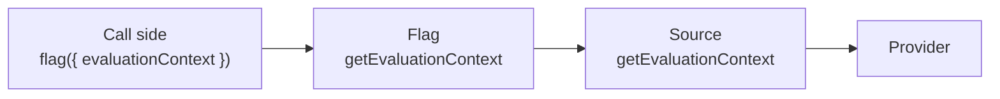

The evaluation context is the data that the provider uses for its rules, e.g. the user, the team or the country. A rule like "on for enterprise teams" or "on for 10% of users" needs it.

In the Flags SDK, the context is created in a chain of up to three steps. Each step receives the result of the step before:



1. The **call side** can give a context: `teamInsights({ evaluationContext: { teamId } })`.
2. The **flag** can convert it, with its own `getEvaluationContext`.
3. The **source** creates the context for the provider, also from the current request: its headers, its cookies and its URL.

Each step is optional. A missing step gives its input to the next step as it is. Without any step and without input, the provider receives an empty context.

<Callout type="info">
  For the ideas behind the evaluation context, see [Evaluation context](/docs/principles/evaluation-context) in Principles.
</Callout>

## The step of the source

Most applications need only this step. The source reads the user from the request, once per request, for all of its flags. With flags files, the step is the default export of `flags/sources/self/context.ts`. This file is optional. Without it, the source has no step:

```ts title="flags/sources/self/context.ts"
import type { FlagsRequest } from 'flags';

export default function getEvaluationContext(
  request: FlagsRequest | undefined,
) {
  return {
    user: request?.cookies?.get('user')?.value ?? 'anonymous',
    country: request?.headers?.get('x-vercel-ip-country') ?? null,
  };
}
```

By hand, it is the option `getEvaluationContext` of `defineSource`:

```ts title="flags/self.ts"
import { defineSource } from 'flags';
import { provider } from './provider';

export const self = defineSource({
  provider,
  getEvaluationContext: (request) => ({
    user: request?.cookies?.get('user')?.value ?? 'anonymous',
    country: request?.headers?.get('x-vercel-ip-country') ?? null,
  }),
});

export const summerSale = self.bindFlag('summerSale');
```

The step receives `request` first, and the input of the step before as the second argument. Leave out the second argument if you do not need it.

```ts
// The call side gives nothing: the source knows the user from the request
await summerSale();
```

The step can be `async`, e.g. to load the user from a session:

```ts title="flags/self.ts"
export const self = defineSource({
  provider,
  getEvaluationContext: async (request) => {
    const session = await getSession(request?.cookies?.get('session')?.value);
    return { user: session?.userId ?? 'anonymous', plan: session?.plan ?? 'free' };
  },
});
```

### The request

`request` is the current request, in the same shape in every framework:

| Field | Type |
| --- | --- |
| `request.headers` | `Headers`-like, read only |
| `request.cookies` | cookies with `get(name)`, `has(name)` and `getAll()`, read only. Read from the `Cookie` header if the framework gives no cookies. |
| `request.url` | `URL` |

The framework package gives the SDK the request (see [Frameworks](/docs/frameworks)). Outside of a request, e.g. in a script, at build time or in a static page, `request` is `undefined`. Thus, always handle `undefined`, e.g. with `request?.cookies?.get('user')?.value ?? 'anonymous'`.

## The step of the call side

Some code knows something that the request does not tell, e.g. an API route knows the team from its path. The call side gives it as `evaluationContext`, and the source decides what it needs:

```ts title="flags.ts"
const teams = defineSource({
  provider,
  // The flags of this source must give a teamId
  getEvaluationContext: async (request, context: { teamId: string }) => ({
    team: await loadTeam(context.teamId),
    user: request?.cookies?.get('user')?.value ?? 'anonymous',
  }),
});

export const teamInsights = teams.bindFlag('teamInsights');
```

```ts title="app/api/teams/[teamId]/insights/route.ts"
const enabled = await teamInsights({ evaluationContext: { teamId } });
```

## The step of the flag

A flag can convert the context between the call side and the source, e.g. when the call side knows the slug of a team, but the source needs its ID:

```ts title="flags.ts"
export const teamInsights = teams.bindFlag('teamInsights', {
  // The call side gives a slug, the source gets a teamId
  getEvaluationContext: (_request, context: { slug: string }) => ({
    teamId: idOfSlug(context.slug),
  }),
});
```

```ts
await teamInsights({ evaluationContext: { slug: 'acme' } });
```

A flag without this step gives the context of the call side directly to the source.

## No automatic merge

Each step returns the complete input of the next step. The SDK does not merge the results. To keep the fields of the step before, spread them:

```ts
getEvaluationContext: (request, context: { teamId: string }) => ({
  ...context,
  user: request?.cookies?.get('user')?.value ?? 'anonymous',
}),
```

No field has a special meaning, also not `targetingKey`. Not all providers use it. If your provider needs it, the source sets it:

```ts
getEvaluationContext: (request) => ({
  targetingKey: request?.cookies?.get('user')?.value ?? 'anonymous',
}),
```

## Types

TypeScript checks the whole chain:

- The type of the second argument of the step of the source is what its flags must give.
- The step of a flag must return that type. The type of its own second argument is what the call side must give.
- The call side may leave out `evaluationContext` only if the input can be `undefined`.

```ts
teamInsights({ evaluationContext: { teamId: 'team-1' } }); // OK
teamInsights(); // Type error: the source needs a teamId
teamInsights({ evaluationContext: { teamId: 1 } }); // Type error: teamId is a string
```

## Once per request

Inside a request, each step runs once for each input. If 20 flags share a source, its `getEvaluationContext` runs once, also when the flags are called in different components:

- Two calls with the same input, or both without input, share one result.
- Plain data is compared by its content: `{ teamId: 't1' }` in two components is one input, also with the keys in a different order.
- Other objects, e.g. a `Date`, a `Map` or an instance of a class, are compared by identity.
- Outside of a request, the steps run on each evaluation.

If a step throws, the flags that use its result fail for the rest of the request: they return their `defaultValue` or throw (see [Errors and default values](/docs/flags/errors-and-default-values)).

## Several flags with one context

`evaluate` gives one context to several flags. Each flag receives the same object, so the step of a shared source runs once. The context must fit each flag, so TypeScript requires the overlap of their contexts:

```ts
const [insights, reports] = await evaluate([teamInsights, teamReports], {
  evaluationContext: { teamId },
});
```

See [Evaluating flags](/docs/flags/evaluating-flags).

## Inline flags

An inline flag has no source. Its `decide(request, context)` receives the request, and the context of the call side as it is. See [Inline flags](/docs/flags/inline-flags#what-decide-receives).

## Tracking events

`track` uses the same chain without the step of the flag: the call side gives `evaluationContext` to the source, and the provider receives the result. See [OpenFeature](/docs/flags/openfeature#tracking).
