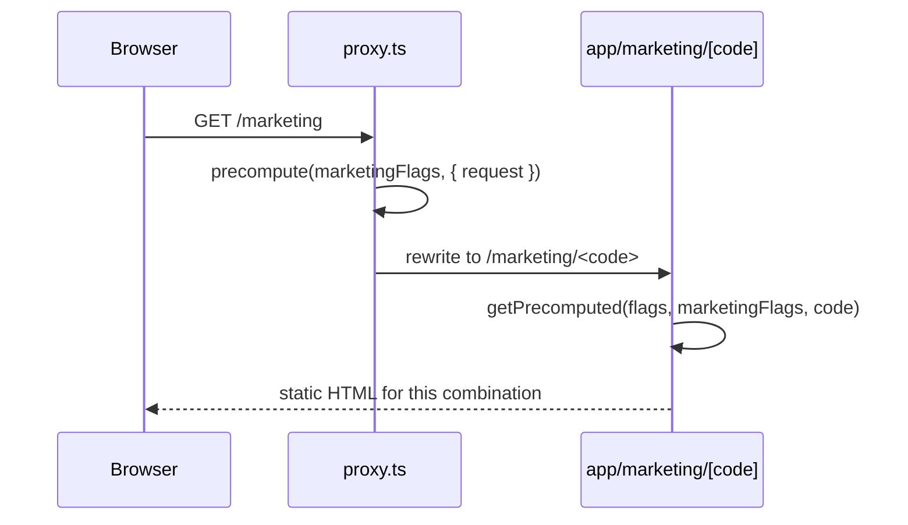

A page that evaluates a flag is dynamic: Next.js renders it for each request. Marketing pages and landing pages should be static and served from the CDN, also while you run A/B tests on them. Precompute solves this:

1. The proxy evaluates the flags of the page for the visitor.
2. It puts their values into a short, signed code and rewrites the request to a URL with that code.
3. Next.js renders one static page for each code, at build time or on the first request.
4. The page reads the values from the code. It does not evaluate the flags again, so it stays static.

The visitor sees the original URL. There is no layout shift and no client-side flicker. See [Precompute](/docs/principles/precompute) for the idea behind the pattern.



Precompute is in `@flags-sdk/next/precompute`. It needs `withFlags` in `next.config.ts` (see [Next.js](/docs/frameworks/next)).

## 1. Group the flags of the page

List the flags that the page uses. The list must be in a separate file, because a `'use flags'` module exports only flags:

```ts title="marketing-flags.ts"
import { checkout, 'summer-sale' as summerSale } from 'flags:self';

export const marketingFlags = [summerSale, checkout] as const;
```

`summer-sale` and `checkout` are flags of the source `self`, from its catalog in `flags/sources/self` (see [Next.js](/docs/frameworks/next)). Any flag works: inline flags and flags of a source, generated or written by hand.

## 2. Precompute in the proxy

```ts title="proxy.ts"
import { precompute } from '@flags-sdk/next/precompute';
import { type NextRequest, NextResponse } from 'next/server';
import { marketingFlags } from './marketing-flags';

export async function proxy(request: NextRequest) {
  // The request goes to the evaluation context chain and to the overrides
  const code = await precompute(marketingFlags, { request });
  return NextResponse.rewrite(new URL(`/marketing/${code}`, request.url));
}

export const config = { matcher: '/marketing' };
```

`precompute` evaluates the flags inside `runtime.onInvoke(request, ...)`, so `getEvaluationContext`, `decide`, and Flags Explorer overrides all see the request of the proxy.

## 3. Read the values in the page

```tsx title="app/marketing/[code]/page.tsx"
import { generatePermutations, getPrecomputed } from '@flags-sdk/next/precompute';
import { checkout, 'summer-sale' as summerSale } from 'flags:self';
import { marketingFlags } from '../../../marketing-flags';

// Optional: build a page for each combination at build time
export async function generateStaticParams() {
  const codes = await generatePermutations(marketingFlags);
  return codes.map((code) => ({ code }));
}

export default async function Page({
  params,
}: {
  params: Promise<{ code: string }>;
}) {
  const { code } = await params;
  const [sale, flow] = await getPrecomputed(
    [summerSale, checkout],
    marketingFlags,
    code,
  );
  return <h1>{sale ? 'Summer sale' : `Checkout: ${flow}`}</h1>;
}
```

`getPrecomputed(flag, group, code)` returns one value, and `getPrecomputed([a, b], group, code)` returns the values in order. A flag that is not part of the group throws.

## Build time or on demand

- **At build time.** `generatePermutations(group)` returns the code of each combination. Boolean flags have the values `false` and `true`. Every other flag needs `options`, or `generatePermutations` throws. Pass a `filter` as the second argument to skip combinations that need no page: `generatePermutations(marketingFlags, (values) => values['summer-sale'] === true)`.
- **On demand (ISR).** Return `[]` from `generateStaticParams`. Next.js renders each combination on its first request and caches it. This avoids long builds when there are many combinations.

`options` describe the known values, but a provider can still return a value outside of them, for example a new variant added after the deployment. Precompute still works: the code then carries the value itself, and Next.js renders that page on demand, unless you set `export const dynamicParams = false`.

## The secret

The code is signed, so a visitor can not choose flag values by editing the URL.

- `withFlags` puts a random secret for each build into the server code, so precompute needs no configuration.
- To set the secret yourself, set `FLAGS_PRECOMPUTE_SECRET` for the build and for the runtime. It is not the `FLAGS_SECRET` of the override cookies.
- Without `withFlags`, set `FLAGS_PRECOMPUTE_SECRET`, or precompute throws.
- Each function also accepts an explicit `secret`.

## Several groups

Precompute the flags that each part of the app needs, not all flags. Each extra flag doubles the number of combinations or more. You can have a group for the whole app and a second group for one page, for example `app/[rootCode]/pricing/[pricingCode]/page.tsx`. Call `precompute` for each group in the proxy and put each code into its segment of the rewrite.

## Identify visitors in the proxy

A/B tests on static pages often target a random visitor ID in a cookie. A static page can not set cookies, so the proxy creates the ID, passes it to the flags, and sets the cookie on the response:

```ts title="proxy.ts"
import { precompute } from '@flags-sdk/next/precompute';
import { type NextRequest, NextResponse } from 'next/server';
import { marketingFlags } from './marketing-flags';

export async function proxy(request: NextRequest) {
  const visitorId =
    request.cookies.get('visitor-id')?.value ?? crypto.randomUUID();

  // The first input of the evaluation context chain, for each flag
  const code = await precompute(marketingFlags, {
    request,
    evaluationContext: { visitorId },
  });

  const response = NextResponse.rewrite(
    new URL(`/marketing/${code}`, request.url),
  );
  response.cookies.set('visitor-id', visitorId, { path: '/' });
  return response;
}

export const config = { matcher: '/marketing' };
```

On the first visit the request has no cookie yet, so the ID goes to the flags through `evaluationContext`. The source then uses it as the targeting key:

```ts title="marketing.ts"
'use flags';

import { VercelProvider } from '@vercel/flags-core/openfeature';
import { bindFlag, defineSource } from 'flags';

const marketing = defineSource({
  provider: new VercelProvider(),
  project: { system: 'vercel-flags' },
  // The input is optional, so the flags also work outside of the proxy
  getEvaluationContext: (
    request,
    input: { visitorId?: string } | undefined,
  ) => ({
    targetingKey:
      input?.visitorId ??
      request?.cookies?.get('visitor-id')?.value ??
      'anonymous',
  }),
});

export const heroTest = bindFlag({
  key: 'hero-test',
  source: marketing,
  defaultValue: false,
});
```

Add `heroTest` to `marketingFlags`.

See [Evaluation context](/docs/flags/evaluation-context) for the context chain.

## Suspense fallbacks

Precomputed values are known in the static shell, so you can use them to pick a matching skeleton. For example, a cheap inline flag that checks whether an auth cookie exists can choose the skeleton of the signed-in state, while the real dashboard streams in (a fragment of a page):

```tsx title="app/[code]/page.tsx"
const signedIn = await getPrecomputed(hasAuthCookie, rootFlags, code);

return (
  <Suspense fallback={signedIn ? <DashboardSkeleton /> : <SignInSkeleton />}>
    <Dashboard />
  </Suspense>
);
```

## Flag values in Flags Explorer

Pass the precomputed values to [`FlagValues`](/docs/frameworks/next/flag-values) with `values`. It then does not read the request, and the page stays static:

```tsx
<FlagValues values={{ [summerSale.key]: sale, [checkout.key]: flow }} />
```

## Upgrading from v4

The API and the format of the code are the same as in v4, and a code of v4 is valid in v5.

- A flag is no longer a function of `(code, group)`. Use `getPrecomputed(flag, group, code)`.
- A flag that is not part of the code throws.
- A non-boolean flag without `options` throws in `generatePermutations`.
- To keep v4 codes valid during the upgrade, set `FLAGS_PRECOMPUTE_SECRET` to the value of your old `FLAGS_SECRET` for that time.

Precompute is not part of the [Flags SDK standard](/docs/standard). It uses only the public API of `flags`.
