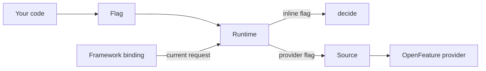

The Flags SDK has a few small parts. Each part has one job, so you can change one without the others.



## Flags

A flag is a function. You call it on the server, and it returns a promise of its value:

```ts
const sale = await summerSale();
```

There are two kinds of flags:

- An **inline flag**, defined with `defineFlag`, decides its value in your code with a `decide` function. See [Inline flags](/docs/flags/inline-flags).
- A **provider flag**, defined with `bindFlag`, asks the provider of a source. See [Provider flags](/docs/flags/provider-flags).

Both kinds get the same features: overrides from Flags Explorer, OpenFeature hooks, one value per request, and type checks.

## Sources and providers

A source connects flags to a flag management system. It has three parts:

- an **OpenFeature provider**, which evaluates the flags,
- optionally, the **project** in the flag management system, for the links of Flags Explorer,
- optionally, `getEvaluationContext`, which creates the **evaluation context** from the request, e.g. the user from a cookie.

With a framework with a bundler, a source is a folder. By convention, the main source of an app is `self`, in `flags/sources/self/`:

- `provider.ts` exports the provider, e.g. `export default new VercelProvider()`,
- `catalog.ts` lists the flags of the source,
- optionally, `context.ts` exports `getEvaluationContext(request, input)`.

With `@vercel/flags-core` in your dependencies, you do not create this folder. The source `self` is then the default source of Vercel Flags: `new VercelProvider()`, and the flags of your Vercel project as the catalog. A file in `flags/sources/self/` replaces its part, e.g. `context.ts` adds the evaluation context.

[Code generation](/docs/flags/code-generation) turns the folder into the module `flags:self`, with the source and one typed flag for each flag of the catalog:

```ts
import { summerSale } from 'flags:self';
```

Without a bundler, e.g. with Hono, Express or plain Node.js, you write the same code by hand. The generated code is the same code you would write:

```ts
const self = defineSource({
  provider: new VercelProvider(),
  project: { system: 'vercel-flags' },
  getEvaluationContext: (request) => ({ user: getUser(request) }),
});

const summerSale = bindFlag({ key: 'summer-sale', source: self });
```

Many flags share one source, and the source creates the context once per request. You can have several sources, e.g. one for Vercel Flags and one for LaunchDarkly. Each flag of a provider names its source: the runtime has no global source to fall back on.

## The runtime

The runtime evaluates flags. For each evaluation it:

1. finds the current request,
2. reads the overrides of [Flags Explorer](/docs/tooling/flags-explorer) from the request,
3. creates the [evaluation context](/docs/flags/evaluation-context): from the call side, through the flag, through the source,
4. runs the OpenFeature hooks, and calls `decide` or the provider,
5. checks the type of the value, and caches it for the rest of the request.

The runtime also owns the lifecycle of the providers. It initializes each provider once, before its first evaluation or at startup, and closes it at shutdown.

There is one runtime for each process, shared by all copies of the `flags` package. So a framework can set it up in one place, and each part of your application sees the same state.

## Framework bindings

The runtime needs the current request: its headers, cookies and URL. Each framework gives it in a different way. A framework binding connects the two:

- It gives the runtime the current request, either with a middleware (`runtime.onInvoke(request, next)`) or with a function that reads the request at any time.
- It loads the optional [configuration files](/docs/flags/configuration) of the folder `flags`, e.g. `flags/hooks.ts`.
- It lets the signals of the framework through, e.g. `redirect()` and `notFound()` in Next.js.
- It registers the modules with the `'use flags'` directive, and writes the [flags manifest](/docs/tooling/flags-manifest) for tools.

Bindings exist for [Next.js, SvelteKit, Nuxt, TanStack Start, Hono and Express](/docs/frameworks). [Without a framework](/docs/frameworks/node), you call `runtime.onInvoke` yourself.

The contract between a framework and the SDK is written down in [the standard](/docs/standard). So any framework can add a binding, and check it with the [conformance suite](/docs/standard/conformance).

## Where flags run

Flags run on the server: in server components, route handlers, loaders, server functions and middleware. The server knows the request, can keep secrets, and can evaluate a flag before the page renders, so there is no layout shift. To use a value in the browser, pass it to the client, e.g. as a prop. See [Server-side vs client-side](/docs/principles/server-side-vs-client-side).
