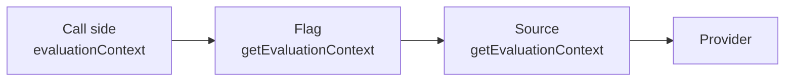

It is common for a feature to be on for some users and off for others. For
example, the team that works on a new setting needs to see it, while everyone
else should not. To make that decision, the provider needs data about the
user: the **evaluation context**.

The Flags SDK separates two steps that most SDKs mix at the call site:

1. **Identifying** who or what the flag is evaluated for.
2. **Deciding** the value of the flag for them.

The provider (or the `decide` function of an inline flag) decides. The
evaluation context chain identifies.

## The chain

The evaluation context is created in a chain of up to three steps. Each step
receives the result of the step before, and the current request:



1. **The call side** can pass what it alone knows, for example the team of the
   current URL: `teamInsights({ evaluationContext: { teamSlug } })`.
2. **The flag** can convert it with its own `getEvaluationContext`, for example
   load the team for the slug.
3. **The source** creates the context for the provider. It usually reads the
   user from the request: its headers, cookies and URL.

A step that is missing passes its input on as it is. Most flags need only the
last step: the source reads the request, and the call site passes nothing.

```ts title="flags.ts"
'use flags';

import { bindFlag, defineSource } from 'flags';
import { provider } from './provider';

const shop = defineSource({
  provider,
  // Runs once per request and input, for all flags of the source
  getEvaluationContext: (
    input: { team?: { plan: string } } | undefined,
    request,
  ) => ({
    user: request?.cookies?.get('user')?.value ?? 'anonymous',
    ...(input?.team ? { team: input.team } : {}),
  }),
});

const teams: Record<string, { plan: string }> = {
  acme: { plan: 'enterprise' },
};

// The call side gives a team slug. The flag loads the team.
export const teamInsights = bindFlag({
  key: 'team-insights',
  source: shop,
  defaultValue: false,
  getEvaluationContext: (context: { teamSlug: string }) => ({
    team: teams[context.teamSlug] ?? { plan: 'unknown' },
  }),
});

// No flag step: the source reads the user from the request
export const summerSale = bindFlag({
  key: 'summer-sale',
  source: shop,
  defaultValue: false,
});
```

```ts
await summerSale();
await teamInsights({ evaluationContext: { teamSlug: 'acme' } });
```

## Why a chain

**Call sites stay small.** Most call sites pass nothing. The source knows how
to find the user, so pages do not rebuild the context, and they can not get it
wrong.

**One value per request.** Each step runs once per request and input, and each
flag is evaluated once per request and input. Two components of one page get
the same value, even when both call the flag. Plain data is compared by its
content, so `{ teamSlug: 'acme' }` from two components counts as one input. You
do not need a `dedupe` helper.

**Types connect the steps.** The type of the `context` parameter of each step
defines what the step before must give. If `teamInsights` needs a
`teamSlug`, calling it without one is a type error. Flags without a source use
the types of the default source, once you register the configuration:

```ts title="flags.config.ts"
declare module 'flags' {
  interface Register {
    config: typeof config;
  }
}
```

**The request is the same in every framework.** Each step receives a
`FlagsRequest` with `headers`, `cookies` and `url`. The framework package
creates it, so the same source works in Next.js, SvelteKit, Hono or a plain
Node.js server. `request` is `undefined` outside of a request, for example at
build time, so handle that case.

## Inline flags

An inline flag has no source and no provider. Its `decide` function receives
the evaluation context of the call side as it is, and the request:

```ts title="flags.ts"
import { defineFlag } from 'flags';

export const betaBanner = defineFlag({
  key: 'beta-banner',
  decide: (_context, request) => request?.cookies?.get('beta')?.value === '1',
});
```

## Passing context from the call side

The call side context is useful for data that only the call site has, such as
a route parameter. Use it for that, and let the source derive everything else
from the request. If many call sites build the same context, move that work
into the flag's or the source's `getEvaluationContext`, so the flag evaluates
the same way everywhere.

`evaluate([a, b], { evaluationContext })` gives one context to several flags.
TypeScript then requires a context that fits all of them.

## Precompute and targeting

[Precompute](/docs/principles/precompute) evaluates flags in Routing
Middleware. There, the evaluation context should come from the request
itself, for example a cookie, so that no database request is needed. See
[Data Locality](/docs/principles/data-locality).

## Learn more

- [Evaluation context](/docs/flags/evaluation-context): the full API of the
  chain.
- [Evaluating flags](/docs/flags/evaluating-flags): calling flags and
  `evaluate()`.
