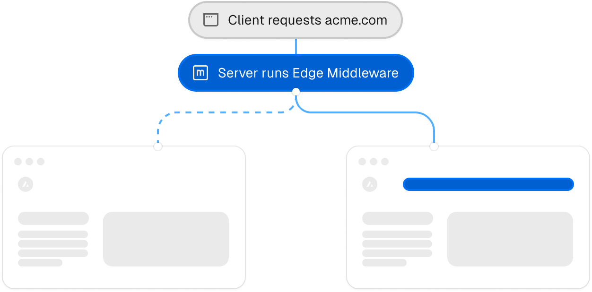

Flags are evaluated per request, so a page that reads a flag is usually
rendered per request. Precompute keeps such a page static. With precompute,
you can:

- Combine multiple feature flags on a single, static page.
- Use Routing Middleware to make the routing decision.
- Generate a page for each combination of flag values at build time, or lazily
  the first time it is requested.
- Cache the pages with Incremental Static Regeneration (ISR).

## How it works

1. Routing Middleware evaluates a group of flags for the request, with the
   same evaluation context chain and overrides as everywhere else.
2. It encodes their values into a short, signed code, and rewrites the request
   to a URL that contains the code, for example `/marketing/<code>`.
3. The page reads the values from the code in its route parameter. It does
   not evaluate the flags again, so it can be rendered statically.

Each combination of values has its own URL, so the CDN caches each variant
separately. The rewrite happens on the server, so visitors only ever see the
original URL.

The code is signed, so visitors can not choose values by editing a URL. A
value that is one of the flag's `options` takes a single byte in the code,
which keeps URLs short.

## The helpers

Rewriting to static variants by hand quickly gets cumbersome as the number of
flags and pages grows. `@flags-sdk/next/precompute` evaluates a group of flags
at once, and reads their values back on the page:

- `precompute(flags, { request })` evaluates the flags in the proxy and returns
  the code.
- `getPrecomputed(flag, flags, code)` reads values from the code on the page.
- `generatePermutations(flags)` returns the code of each combination, for
  `generateStaticParams`.
- `serialize` and `deserialize` convert between values and codes.

```ts title="proxy.ts"
import { precompute } from '@flags-sdk/next/precompute';
import { type NextRequest, NextResponse } from 'next/server';
import { marketingFlags } from './flags';

export async function proxy(request: NextRequest) {
  const code = await precompute(marketingFlags, { request });
  return NextResponse.rewrite(new URL(`/marketing/${code}`, request.url));
}

export const config = { matcher: '/marketing' };
```

To build every variant ahead of time, `generatePermutations` needs to know the
possible values of each flag. Boolean flags have `false` and `true`. Give every
other flag `options`.

## What changed in v5

- Precompute is a feature of the Next.js package, in
  `@flags-sdk/next/precompute`. It is not part of the core runtime or of the
  [standard](/docs/standard), and it uses only the public API of `flags`.
- Read precomputed values with `getPrecomputed`. A flag is no longer a function
  of `(code, group)`.
- The secret that signs codes is `FLAGS_PRECOMPUTE_SECRET`. `withFlags`
  creates a random secret for each build, so precompute works without
  configuration. To keep codes of v4 valid during the upgrade, set
  `FLAGS_PRECOMPUTE_SECRET` to the value of `FLAGS_SECRET` for that time.
- The format of the code is the same as in v4.

<Callout>
  Precompute is currently available for Next.js. Other frameworks can use the
  same pattern with their own middleware and rewrites.
</Callout>

See [Precompute in Next.js](/docs/frameworks/next/precompute) for a complete
walkthrough, and the [API reference](/docs/api-reference/next#precompute) for
every function.
