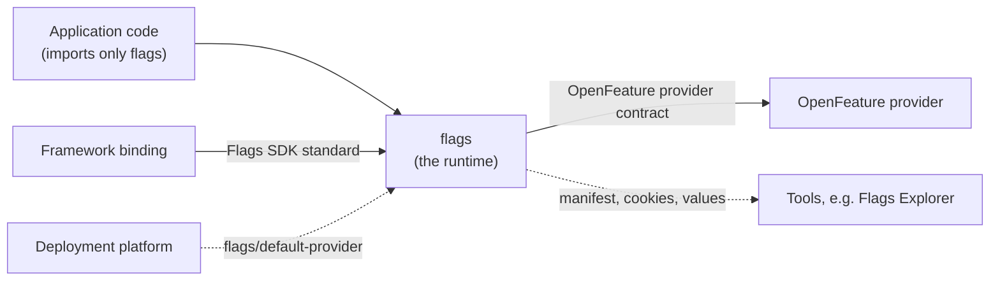

**Status:** Version 1, draft. The normative text is [STANDARD.md](https://github.com/vercel/flags/blob/main/packages/flags/STANDARD.md) in the Flags SDK repository. These pages explain it; where they differ, STANDARD.md wins.

Feature flags are a cross-cutting concern. A flag is declared in application code, evaluated by a provider, called during a request of a framework, deployed on a platform, and inspected by tools. Today, each combination needs its own glue: an SDK for each framework, an adapter for each vendor, a discovery endpoint for each tool.

The Flags SDK standard replaces this glue with a small set of contracts. An implementation which follows the standard works with every other implementation which follows it:

- an application written once works with **any framework** which has a conforming binding;
- a framework binding works with **any provider**, because the provider contract is OpenFeature;
- a tool works with **any application**, because the flags manifest, the override cookie and the flag values in the page have one format.

## Why a standard

**Frameworks own the request.** A flag value depends on the request: its cookies, its headers, the user. Only the framework knows the current request, and only the framework knows its control flow, e.g. that a thrown value is a redirect. A flags library which guesses gets this wrong. The standard makes the framework give the SDK exactly what it needs, in one shape: [`FlagsRequestInit`](/docs/standard/framework-bindings#the-request).

**Providers already have a standard.** [OpenFeature](https://openfeature.dev/) defines how a flag management system evaluates a flag. The Flags SDK does not define a second provider format. It uses OpenFeature server providers as they are, and adds what OpenFeature leaves to the host: the request, one evaluation context per request, overrides, and typed flags.

**Tools need data, not code.** Flags Explorer and similar tools need to know which flags exist, how to override them, and which values a page used. The standard defines these as documents and cookies, not as an API of one SDK, so that a tool can support every framework at once.

**Platforms need a seam.** A deployment platform can make flags faster, e.g. with a provider which reads flag data at the edge of its network. The standard defines where a platform plugs in, and guarantees that the configuration of the application always wins.

## The roles

| Role | Who | What they implement | Where |
| --- | --- | --- | --- |
| **Application author** | You, building an app | Flags with `defineFlag` and `bindFlag`, sources with `defineSource`, `flags/config.ts`. Imports only `flags`. | [Flags](/docs/flags) |
| **Framework author** | A framework, or its package `@flags-sdk/<framework>` | A framework binding and, with a bundler, a build plugin | [Framework bindings](/docs/standard/framework-bindings) |
| **Provider author** | A flag management system, e.g. LaunchDarkly | An OpenFeature server provider; optionally a system manifest for dashboard links | [Custom providers](/docs/providers/custom-providers), [Flags manifest format](/docs/standard/flags-manifest-format#system-manifests) |
| **Platform** | A deployment platform, e.g. Vercel | Optionally a default provider; the flags manifest in its build output; signed override tokens | [Framework bindings](/docs/standard/framework-bindings#deployment-platforms) |
| **Tool author** | E.g. Flags Explorer | Reads the flags manifest and the flag values; writes the override cookie | [Flags manifest format](/docs/standard/flags-manifest-format) |

Application authors do not need to read the standard. It exists so that the parts below the application fit together.

## Two contracts

- **Between the SDK and providers: OpenFeature.** The provider contract is the [OpenFeature specification](https://openfeature.dev/specification/), without changes or extensions. The standard does not repeat it.
- **Between frameworks and the SDK: this standard.** It defines how a framework gives the SDK the request, the configuration, and its signals, and how a build plugin discovers flags.
- **Between applications and tools: this standard.** It defines the flags manifest, the override tokens, and the flag values in the page.

## What is in scope

The standard has these parts. The section numbers refer to STANDARD.md.

| Part | Sections | Page |
| --- | --- | --- |
| The request: `FlagsRequestInit`, the identity of a request | 3 | [Framework bindings](/docs/standard/framework-bindings#the-request) |
| The replaceable modules: `flags/framework`, `flags/config`, `flags/default-provider` | 4 | [Framework bindings](/docs/standard/framework-bindings#the-replaceable-modules) |
| The framework binding: request source, signals, config source, caches | 5 | [Framework bindings](/docs/standard/framework-bindings#the-framework-binding) |
| `flags/config.ts` | 6 | [Framework bindings](/docs/standard/framework-bindings#flagsconfigts) |
| Discovery: `'use flags'` modules and the flags manifest | 7 | [Flags manifest format](/docs/standard/flags-manifest-format) |
| Deployment platforms | 8 | [Framework bindings](/docs/standard/framework-bindings#deployment-platforms) |
| Flag management systems and system manifests | 9 | [Flags manifest format](/docs/standard/flags-manifest-format#system-manifests) |
| Overrides | 10 | [Overrides](/docs/tooling/overrides) |
| Flag values in the page | 11 | [Flags Explorer](/docs/tooling/flags-explorer#flag-values-in-the-page) |
| The conformance suite | 12 | [Conformance](/docs/standard/conformance) |

## What is out of scope

- **The provider contract.** It is OpenFeature.
- **The API for applications.** `defineFlag`, `bindFlag`, `evaluate` and the other exports of `flags` are the API of the SDK, documented in [Flags](/docs/flags). They follow semantic versioning, not this standard.
- **Client-side evaluation.** The standard covers flags which are evaluated on the server. Applications give values to the client, e.g. as props.
- **The user interface of tools.** The standard defines the data which a tool reads and writes, not how it shows it.

## Conformance classes

An implementation conforms to one or more classes:

| Class | Implemented by | Sections |
| --- | --- | --- |
| Framework binding | a framework, or its package `@flags-sdk/<framework>` | 3, 4, 5, 6 |
| Build plugin | a framework with a bundler | 4, 7 |
| Deployment platform | e.g. Vercel | 4.3, 8, 11.3 |
| Flag management system | e.g. LaunchDarkly | 9 |
| Tool | e.g. Flags Explorer | 7.3, 9.2, 10, 11 |

A framework binding SHOULD pass the [conformance suite](/docs/standard/conformance).

## Requirement keywords

The key words MUST, MUST NOT, REQUIRED, SHALL, SHALL NOT, SHOULD, SHOULD NOT, RECOMMENDED, MAY and OPTIONAL are to be interpreted as described in [RFC 2119](https://www.rfc-editor.org/rfc/rfc2119) and [RFC 8174](https://www.rfc-editor.org/rfc/rfc8174) when, and only when, they appear in all capitals. These pages use them only when they restate a requirement of STANDARD.md.

## Terminology

- **Flag management system (system):** the source of truth of the flags, as defined by OpenFeature, e.g. LaunchDarkly or Vercel Flags.
- **Provider:** an OpenFeature provider of a system.
- **Source:** a provider plus a flag project in a system.
- **Deployment platform (platform):** where the application runs, e.g. Vercel. A platform project has many deployments.
- **Framework binding (binding):** the module which connects the SDK to one framework.
- **Build plugin:** the part of a framework integration which configures the bundler.
- **The runtime:** the object `runtime` of the package `flags`.
- **Flags manifest:** the JSON description of the flags of an application.
- **System manifest:** the JSON file of a system with the templates of the links to its dashboard.

## Versioning

This is version 1 of the standard. The manifest formats have their own `version` field. A change which makes a conforming implementation not conform is a new major version of the standard, and of the package `flags`.

## Reference implementations

- **Framework bindings:** [`packages/framework-*`](https://github.com/vercel/flags/tree/main/packages) for Next.js, SvelteKit, Nuxt, TanStack Start, Hono and Express. Each uses only the public API of `flags`, so a framework can take its package over, vendor it, or implement the same itself.
- **Test applications:** [`tests/standard`](https://github.com/vercel/flags/tree/main/tests/standard) has one application for each framework, with the conformance suite and more end-to-end tests over HTTP.
- **Guide for implementers:** [FRAMEWORK-AUTHORS.md](https://github.com/vercel/flags/blob/main/packages/flags/FRAMEWORK-AUTHORS.md).

The standard is a draft. Feedback from framework, platform and provider authors is welcome as [issues on GitHub](https://github.com/vercel/flags/issues).
