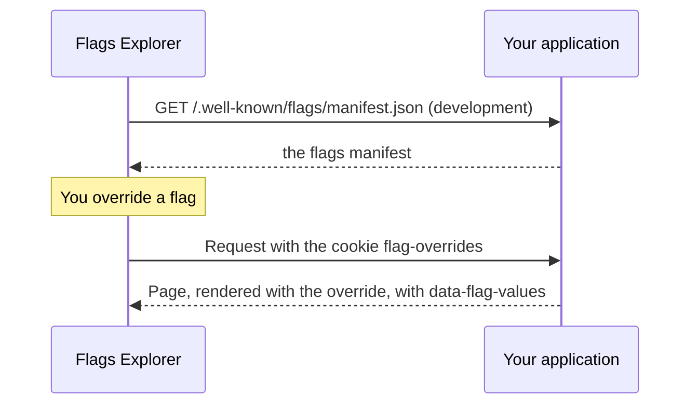

[Flags Explorer](https://vercel.com/docs/flags/flags-explorer) is part of the [Vercel Toolbar](https://vercel.com/docs/vercel-toolbar). It shows the flags of your application, lets you override a flag for your own browser, and shows the values which a page used. Teammates can test a feature in production or in a preview, without changing it for anyone else.

Flags Explorer works with the Flags SDK through three open interfaces, which are part of the [Flags SDK standard](/docs/standard):

| What Flags Explorer does | How | Page |
| --- | --- | --- |
| Lists your flags, with their type, options, description and dashboard link | Reads the **flags manifest** | [The flags manifest](/docs/tooling/flags-manifest) |
| Overrides a flag for your browser | Sets the **`flag-overrides` cookie** | [Overrides](/docs/tooling/overrides) |
| Shows the values which the page used | Reads the **`data-flag-values` elements** of the page | [Flag values in the page](#flag-values-in-the-page) |



Nothing in this flow is specific to one framework or one provider. Any framework with a [binding](/docs/standard/framework-bindings) and any OpenFeature provider work with Flags Explorer.

## Set up Flags Explorer

### 1. Add the Vercel Toolbar

On Vercel, the toolbar is available on preview deployments, and you can enable it for production. For local development, add the toolbar to your application. See [the Vercel Toolbar documentation](https://vercel.com/docs/vercel-toolbar) for your framework.

### 2. Put your flags into `'use flags'` modules

A module which starts with `'use flags'` exports only flags. The framework plugin finds these modules, and writes the manifest of your flags:

```ts title="flags.ts"
'use flags';

import { bindFlag } from 'flags';

export const checkout = bindFlag({
  key: 'checkout',
  type: 'string',
  options: ['control', 'express'],
  defaultValue: 'control',
  description: 'The checkout flow',
});
```

Flags generated by [code generation](/docs/flags/code-generation) are in `'use flags'` modules already.

With Next.js, add one route file, which serves the manifest in development:

```ts title="app/.well-known/flags/manifest.json/route.ts"
export { GET } from '@flags-sdk/next/manifest';
```

The plugins of SvelteKit, Nuxt and TanStack Start serve the manifest without a route file. See [The flags manifest](/docs/tooling/flags-manifest) for each framework.

### 3. Let the application trust the overrides

Flags Explorer sets an override cookie which Vercel signs. The SDK accepts it without configuration:

- on Vercel;
- locally, after `vercel link` and `vercel env pull`.

If you set `FLAGS_SECRET`, the SDK accepts only overrides which are encrypted with it. See [Overrides](/docs/tooling/overrides).

### 4. Optional: write the flag values into the page

So that Flags Explorer can show which values a page used, write them into the page. With Next.js, use `FlagValues`:

```tsx title="app/layout.tsx"
import { FlagValues } from '@flags-sdk/next/flag-values';
import { checkout, summerSale } from '../flags';

export default function Layout({ children }: { children: React.ReactNode }) {
  return (
    <html lang="en">
      <body>
        {children}
        <FlagValues flags={[summerSale, checkout]} />
      </body>
    </html>
  );
}
```

See [Flag values](/docs/frameworks/next/flag-values) for the options of `FlagValues`.

## Flag values in the page

The values are in an element of the page:

```html
<script type="application/json" data-flag-values>"eyJhbGciOi..."</script>
```

The values are encrypted by default, so that visitors cannot read them:

- **With `FLAGS_SECRET`**, they are encrypted with this secret, in the format of v4 of the SDK.
- **Without `FLAGS_SECRET`**, they are encrypted with a public key of Vercel. Only Vercel can decrypt them.

Other frameworks write the element with the functions of `flags`:

```ts
import { encryptFlagValues, serializeFlagValues } from 'flags';

const content = serializeFlagValues(
  await encryptFlagValues({ 'summer-sale': true, checkout: 'express' }),
);
const html = `<script type="application/json" data-flag-values>${content}</script>`;
```

`serializeFlagValues` escapes the content, so that it cannot end the element. Without `encryptFlagValues`, the values are plain JSON, and each visitor can read them. Use that only if this is acceptable.

## Dashboard links

When a source names its flag project with `project`, the manifest has the variables of the project, e.g. the `projectId`. Flags Explorer builds the links to the dashboard of your flag management system from them, with the [system manifest](/docs/standard/flags-manifest-format#system-manifests) of the system. The links are not in your build, so a system can change its URLs without a new deployment of your application.

```ts title="sources.ts"
import { VercelProvider } from '@vercel/flags-core/openfeature';
import { defineSource } from 'flags';

export const vercel = defineSource({
  provider: new VercelProvider(),
  project: { system: 'vercel-flags' },
});
```

## What works today

Flags Explorer and the Flags SDK v5 are new. This is the current state:

| Feature | Status |
| --- | --- |
| Flags of the manifest in development (`/.well-known/flags/manifest.json`) | Available |
| Overrides signed by Vercel (`flag-overrides`), on Vercel and locally after `vercel env pull` | Available |
| Overrides encrypted with `FLAGS_SECRET` | Available |
| Flag values in the page, encrypted with `FLAGS_SECRET` | Available |
| Flag values in the page, encrypted with the public key of Vercel | Not yet: Flags Explorer does not send them to Vercel for decryption yet |
| Flags of a deployment from its `flags-manifest.json` | Not yet: Flags Explorer shows the flags of a deployment from the values of the page, not from the manifest of the build |
| Dashboard links for Vercel Flags | Available |
| Dashboard links for other systems, e.g. LaunchDarkly | Not yet: Flags Explorer builds links only for Vercel Flags |
| `FlagValues` component | Next.js. Other frameworks use `encryptFlagValues` and `serializeFlagValues` |

There is no public endpoint for the manifest in production, by design: the manifest of a deployment comes from its build output. Until Flags Explorer reads it, you see the full list of flags in development, and the flags which a page used in deployments.

## Troubleshooting

- **Flags Explorer shows no flags.** Check that your flags are in a module which starts with `'use flags'`, and open `/.well-known/flags/manifest.json` in development. With Next.js, check the route file.
- **An override has no effect.** Check the warning in the server logs, e.g. `flags: The override cookie was ignored. Reason: wrong-scope.` Check that `FLAGS_SECRET` is the same in your application and in the project settings, or that it is not set if you rely on overrides signed by Vercel. An override value of a different type than the flag is ignored.
- **A flag shows no dashboard link.** Set `project` on its source. Flags without a known system have no link.
