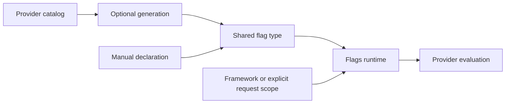

# Flags system design and release plan

> **Status (2026-11):** `packages/flags-protocol` is joined into `packages/flags`
> (milestones M0 to M7 in "The move to sources" of
> [the SPEC](../packages/flags/SPEC.md)). "Connection" is now "source"
> (`defineSource`), flags of a source use `bindFlag`, inline flags use
> `defineFlag` with `decide`, and code generation is in `flags/tooling` and
> `withFlags({ codeGeneration })`. "Current implementation" and "Code reading
> order" below describe the state before the join.

Flags connects server applications, frameworks, and flag providers through shared
contracts and one evaluation runtime.

**Code generation is optional.** An application can declare flags with
`defineFlag(...)`, or generate them from provider metadata and import them through
`flags:<source>`. Both paths must produce the same flag type and use the same
runtime. The core must work without a catalog, bundler, directive, or build plugin.

This is the proposed major-release design. The implementation gaps and release
decisions follow the design below.

```ts
// With catalog generation:
import { newCheckout } from 'flags:site';

const enabled = await newCheckout();
```

Manual flags use ordinary module imports; the call stays the same. `'use flags'`
can support discovery. Every transform must have an explicit API equivalent.



## Responsibilities

| Part | Owner | Responsibility |
| --- | --- | --- |
| Contracts | Flags standard | Flags, connections, requests, catalogs, results, lifecycle, and conformance tests. |
| Runtime | `flags` | Context resolution, provider lifecycle, evaluation, validation, caching, overrides, and hooks. |
| Catalog tooling | `flags`, optional | Catalog loading and watching, typed exports, JSDoc, and module mappings. |
| Provider integration | Provider authors | Evaluation, optional catalog access, transport, and authentication. |
| Framework integration | Framework authors | Request scope and rendering behavior; optional build integration for generation and discovery. |
| Application configuration | Application authors | Provider project selection, context mapping, and runtime policy. |

The code in `flags-protocol` should ultimately join `flags`, with separate import
graphs for build tooling and runtime code. `flags` currently supports OpenFeature
providers for evaluation; catalog access is an additional capability.

## Sources and connections

A **connection** binds a provider instance for a particular project and environment
to an application context resolver. A **source** adds catalog access and a name
for generated imports. A **scope** holds the state of one request or explicit job.

```text
flags/sources/site/
  catalog.ts    # Metadata for development and builds
  provider.ts   # Provider instance for runtime evaluation
  context.ts    # Application context resolver
```

`site` selects `flags:site`. Generation imports only `catalog.ts`; generated
application modules import `provider.ts` and `context.ts`. Shared project settings
must be safe to load in build tooling. Catalog code must not import runtime
providers or request APIs. Credentials must never enter generated files.

Manual connections need neither this directory layout nor `catalog.ts`. A central
`flags/config.ts` is not required by the proposed source model. The final API for
global runtime policy, such as hooks and overrides, is still open.

## Types and evaluation context

For generated flags, the provider owns keys, value types, variants, defaults, and
the accepted context shape. Tooling creates exports and types; normal module and
TypeScript checks reject unknown imports. Without a catalog, manual declarations
supply metadata, without compile-time validation against remote keys.

The application supplies targeting values through normalized request inputs:

```ts
getEvaluationContext({ cookies, headers })
```

`cookies.get(name)` returns `{ value }` or `undefined`. `headers.get(name)` is
case-insensitive and returns a string or `null`. Framework bindings supply these
interfaces, so context code needs no framework imports.

The provider constrains the resolver's output type. The flag defines its caller's
input type. For calls with inputs, the required chain is:

```text
call inputs → optional flag context transform → connection resolver → provider
```

The connection has the final say. Without call inputs, resolve context once per
connection/request, including concurrent calls. With inputs, distinguish different
connection inputs. Input equality, error caching, and the combined resolver
signature remain open. Context caching and result caching are separate decisions.

## Catalog lifecycle

A catalog loader returns a snapshot or an async iterable of complete snapshots.
Generate from the first snapshot, then update exports on later snapshots. The
loader owns retries and must release resources on cancellation or iterator close.

The Next.js plugin currently owns this lifecycle:

| Phase | Catalog work |
| --- | --- |
| `next dev` | Generate before resolving imports, then watch. |
| `next build` | Generate once, then close subscriptions. |
| `next start` | Use compiled output; no catalog generation. |

`flags sync` and `flags watch` expose the same tooling. The playground subscribes
to Vercel's NDJSON `/v1/stream` with OIDC. Runtime evaluation separately uses
`@vercel/flags-core`. Catalog watch updates the code contract; the runtime provider
updates evaluation data. An existing boolean flag can change without a rebuild.

The **catalog** describes available flags. A **resolution map** maps `flags:site`
to a module. An **application usage manifest** describes used flags. The
prototype's `.flags/manifest.json` is only a resolution map; precompute needs
separate information about flags used by a page.

## Current implementation

| Area | Current state |
| --- | --- |
| `packages/flags` | Runtime with OpenFeature providers, context chains, request caches, hooks, overrides, tracking, and manual flags. Uses the earlier configuration model. |
| `packages/flags-protocol` | Catalog tooling plus a separate, smaller runtime. Generated modules import `flags/next`. |
| Playground | Installs the protocol package under the name `flags`. Calls `@vercel/flags-core` directly, without its OpenFeature provider. |
| Context and values | Protocol scope shares context and its failure per connection/request, but does not cache values. `flags` caches results per flag/request/input, except with call hooks or hook hints. |
| Metadata | Protocol catalogs contain identity, revision, variants, and descriptions. Defaults and context schemas are absent. Vercel context is currently `Record<string, unknown>`; descriptions are demo text. |
| Live changes | Catalog updates regenerate files. Source-file and source-directory changes require restart. |

The prototype demonstrates typed imports and live generation. Generated functions
still need the shared runtime and flag metadata for manifests and precompute.
The protocol runtime also lacks per-call inputs, flag context transforms, and
provider shutdown.

## Release decisions and acceptance checks

Resolve these in order. Each decision must apply to both authoring paths.

1. **Unify the runtime and provider contract.** Generate through the public flag
   API and remove Next.js imports from shared generated code. Preserve provider
   lifecycle, framework signals, overrides, and hooks. Test both authoring paths
   with Next.js, a second framework, and an explicit scope without a bundler.
   Extend the existing conformance suite for these cases.

2. **Specify request and identity semantics.** Define context input equality,
   result caching, retry behavior, and hook invocation counts. Distinguish equal
   flag keys from different sources in caches, overrides, events, and manifests.
   Test concurrency, different inputs, separate requests, failures, and jobs.

3. **Specify metadata and failure policy.** Separate a provider's normal default
   from the value used when evaluation fails. Define behavior for missing flags,
   wrong projects, and new variants after deployment. The prototype throws for
   values outside its generated variant set. Choose schema/version rules and
   fallback or error behavior; remote changes cannot widen deployed TypeScript types.

4. **Make generation reliable across environments.** Choose how CI gets a
   reproducible catalog snapshot and how editors work before the first dev run.
   Decide whether to commit output or restore it from a snapshot.
   Test malformed catalogs, unavailable credentials, interrupted writes,
   reconnects, source changes, duplicate workers, and shutdown. Support the manual
   path without installing or running catalog tooling.

5. **Finish configuration and diagnostics.** Select the API for runtime policy
   without importing it into build configuration. Preserve source, key, reason,
   variant, and error for tracing and tests. Define events for cached calls. Keep
   evaluation and experiment exposure distinct. Verify test overrides and omit
   credentials and user context from diagnostics by default.

Frameworks own delivery of server-evaluated values to clients. Client-only flags
and cross-provider failover remain out of scope. Precompute and developer tools
are optional consumers of the shared contracts.

## Code reading order

1. [Sources](../packages/flags/src/source.ts),
   [catalogs](../packages/flags/src/catalog.ts), and the
   [generator](../packages/flags/src/codegen.ts): the contracts of a source and
   of the code generation.
2. [Flags runtime](../packages/flags/src/runtime.ts) and
   [flag API](../packages/flags/src/flag.ts): see the behavior to consolidate.
3. [Next.js binding](../packages/framework-next/src/binding.ts) and
   [code generation of the plugin](../packages/framework-next/src/code-generation.ts):
   the runtime and build integrations.
4. [Playground setup](../apps/playground/README.md) and
   [conformance suite](../packages/conformance/README.md): run the demo and inspect
   existing checks. The current [standard draft](../packages/flags/STANDARD.md)
   still requires the earlier config model and must be reconciled before release.
