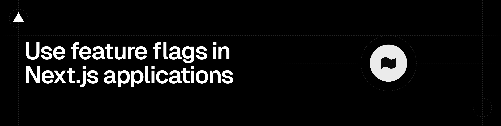

# Flags SDK

The feature flags toolkit for every framework.

From the creators of Next.js, the Flags SDK is a free open-source library that gives you the tools you need to use feature flags in your application.

- One API for all frameworks: declare a flag once, and use it in Next.js, SvelteKit or plain server code
- Works with any flag provider, custom setups or no flag provider at all
- Compatible with the App Router, the Pages Router and routing middleware
- Built for feature flags and experimentation

See [flags-sdk.dev](https://flags-sdk.dev/) for full docs and examples.

> This is version 5, a prerelease (`npm install flags@standard`). See [Upgrading from v4](#upgrading-from-v4).

## Installation

Install `flags` and the package of your framework:

```sh
# Next.js
npm install flags @flags-sdk/next

# SvelteKit
npm install flags @flags-sdk/sveltekit
```

## Setup

The package of your framework gives the SDK the current request. Add its build plugin.

Next.js (16 or later, with Turbopack):

```ts
// next.config.ts
import { withFlags } from '@flags-sdk/next/plugin';

export default withFlags({});
```

SvelteKit (2.20 or later):

```ts
// vite.config.ts
import { sveltekit } from '@sveltejs/kit/vite';
import { flags } from '@flags-sdk/sveltekit/vite';
import { defineConfig } from 'vite';

export default defineConfig({ plugins: [sveltekit(), flags()] });
```

The plugin points the alias `flags/framework` to the binding of the framework. Then a flag reads the headers and the cookies of the current request: in Next.js from `headers()` and `cookies()`, in SvelteKit from `getRequestEvent()`.

## Usage

Declare your flags in a file of their own, e.g. `flags.ts`:

```ts
// flags.ts
import { flag } from 'flags';

export const showBanner = flag<boolean>({
  key: 'show-banner',
  defaultValue: false,
  decide({ cookies }) {
    return cookies.get('beta')?.value === '1';
  },
});
```

Call the flag on the server. In a React Server Component of Next.js:

```tsx
// app/page.tsx
import { showBanner } from '../flags';

export default async function Page() {
  const banner = await showBanner();
  return <div>{banner ? 'Banner is on' : 'Banner is off'}</div>;
}
```

In a `load` function of SvelteKit:

```ts
// src/routes/+page.server.ts
import { showBanner } from '$lib/flags';

export async function load() {
  return { banner: await showBanner() };
}
```

When `decide` throws or returns `undefined`, the flag returns its `defaultValue`. Signals of the framework, e.g. `redirect()` or `notFound()`, are thrown again.

To evaluate more than one flag, use `evaluate`:

```ts
import { evaluate } from 'flags';

const [banner, checkout] = await evaluate([showBanner, newCheckout]);
```

### Passing the request

Where the framework gives no current request, pass it yourself. This works without a build plugin:

```ts
// The Pages Router of Next.js, or routing middleware
const banner = await showBanner(request);

// The reroute hook of SvelteKit
const code = await precompute(marketingFlags, request);
```

The request can be a Web `Request`, a `NextRequest`, or an `IncomingMessage` of the Pages Router.

### Precompute

Precompute evaluates a group of flags once, e.g. in routing middleware, and puts their values into a short, signed code in the URL. The page reads the values from the code, so it can stay static:

```ts
import { flag, generatePermutations, precompute } from 'flags';

export const marketingFlags = [showBanner, newCheckout] as const;

// routing middleware
const code = await precompute(marketingFlags, request);

// the page, e.g. app/[code]/page.tsx
const banner = await showBanner(code, marketingFlags);

// build all pages at build time
const codes = await generatePermutations(marketingFlags);
```

## `FLAGS_SECRET` (optional)

On Vercel, the SDK works without a `FLAGS_SECRET`. Flags Explorer overrides and the flags discovery endpoint use tokens that Vercel signs, `encryptFlagValues` encrypts flag values with the public key of Vercel, and precompute signs its codes with a key that Vercel provides for each deployment. For local development, run `vercel env pull` so the SDK can identify your project. On Vercel, your project must expose the [system environment variables](https://vercel.com/docs/environment-variables/system-environment-variables).

You still need a `FLAGS_SECRET` to [precompute](https://flags-sdk.dev/principles/precompute) flags in production outside of Vercel or in a prebuilt deployment (`vercel build` and `vercel deploy --prebuilt`), when your project does not expose the system environment variables, to use Flags Explorer outside of Vercel or locally without `vercel env pull`, or to create your own encrypted overrides, for example in end-to-end tests. Projects that already have a `FLAGS_SECRET` keep working without changes.

The `FLAGS_SECRET` value must have a specific length (32 random bytes encoded in base64) to work as an encryption key. Create one using node:

```sh
node -e "console.log(crypto.randomBytes(32).toString('base64url'))"
```

Use a separate `FLAGS_SECRET` value for each environment (Development, Preview, Production), and mark the Preview and Production values as Sensitive. Run the generator once per environment to produce distinct values, then store each on Vercel:

```sh
vercel env add FLAGS_SECRET production --sensitive --value <production-secret>
vercel env add FLAGS_SECRET preview --sensitive --value <preview-secret>
vercel env add FLAGS_SECRET development --value <development-secret>
```

When set, the SDK uses this secret to read overrides, to encrypt flag values in case they are sent to the client and should stay secret, and to sign precomputed codes. The SDK also reads it from the environment of the framework, e.g. `$env` of SvelteKit during `vite dev`.

## Adapters

The Flags SDK has adapters for popular feature flag providers including LaunchDarkly, Optimizely, and Statsig. An adapter supplies the `decide` function of a flag:

```ts
import { flag } from 'flags';
import { vercelAdapter } from '@flags-sdk/vercel';

export const showBanner = flag<boolean>({
  key: 'show-banner',
  adapter: vercelAdapter(),
});
```

## Upgrading from v4

- Import `flag`, `evaluate`, `dedupe`, `precompute`, `generatePermutations` and `getPrecomputed` from `flags`. `flags/next` and `flags/sveltekit` are removed.
- Add the build plugin of your framework (see [Setup](#setup)). Next.js needs version 16 and Turbopack.
- `createFlagsDiscoveryEndpoint` comes from `@flags-sdk/next` or `@flags-sdk/sveltekit`, and `createHandle` from `@flags-sdk/sveltekit`. In SvelteKit, `createHandle` is optional: a flag gets the request from `getRequestEvent()`.
- The rules of `flags/next` apply in all frameworks. In SvelteKit, this changes: a flag returns its `defaultValue` when `decide` throws or returns `undefined`, the cache of a request is per flag and entities, and `identify` runs for each evaluation.

## For framework authors

A framework package gives the SDK the current request with a binding: a module which exports `binding`, of the type `FrameworkBinding` of `flags`. Its build plugin points the alias `flags/framework` to that module, e.g. as `@flags-sdk/next` and `@flags-sdk/sveltekit` do. The module must not import `flags` at runtime, because `flags` imports it.

```ts
import type { FrameworkBinding } from 'flags';

export const binding: FrameworkBinding = {
  name: 'my-framework',
  async getHeaders() {
    // The headers of the current request: the same object during a request
  },
  async getRequest() {
    // { headers, cookies? } of the current request
  },
  isFrameworkSignal(error) {
    // Whether the framework must receive the error, e.g. a redirect
    return false;
  },
};
```

## Documentation

There is a lot more to the Flags SDK than shown in the examples above.

See the full documentation and examples on [flags-sdk.dev](https://flags-sdk.dev/).
