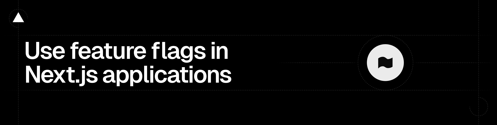

# Flags SDK

The feature flags toolkit for Next.js and SvelteKit.

From the creators of Next.js, the Flags SDK is a free open-source library that gives you the tools you need to use feature flags in Next.js and SvelteKit applications.

- Works with any flag provider, custom setups or no flag provider at all
- Compatible with App Router, Pages Router, and Routing Middleware
- Built for feature flags and experimentation

See [flags-sdk.dev](https://flags-sdk.dev/) for full docs and examples.

> Upgrading from version 3? See the [Upgrade to v4](https://github.com/vercel/flags/blob/main/packages/flags/guides/upgrade-to-v4.md) guide.

## Installation

Install the package using your package manager:

```sh
npm install flags
```

## Setup

On Vercel, the SDK works without a `FLAGS_SECRET`. Flags Explorer overrides and the flags discovery endpoint use tokens that Vercel signs, `encryptFlagValues` encrypts flag values with the public key of Vercel, and precompute signs its codes with a key that Vercel provides for each deployment. For local development, run `vercel env pull` so the SDK can identify your project. On Vercel, your project must expose the [system environment variables](https://vercel.com/docs/environment-variables/system-environment-variables).

### `FLAGS_SECRET` (optional)

You still need a `FLAGS_SECRET` to [precompute](https://flags-sdk.dev/principles/precompute) flags outside of Vercel or in a prebuilt deployment (`vercel build` and `vercel deploy --prebuilt`), to use Flags Explorer outside of Vercel or locally without `vercel env pull`, or to create your own encrypted overrides, for example in end-to-end tests. Projects that already have a `FLAGS_SECRET` keep working without changes.

The `FLAGS_SECRET` value must have a specific length (32 random bytes encoded in base64) to work as an encryption key. Create one using node:

```sh
node -e "console.log(crypto.randomBytes(32).toString('base64url'))"
```

Use a separate `FLAGS_SECRET` value for each environment (Development, Preview, Production), and mark the Preview and Production values as Sensitive. Run the generator once per environment to produce distinct values, then store each on Vercel:

```sh
vercel env add FLAGS_SECRET production --sensitive --value <production-secret>
vercel env add FLAGS_SECRET preview --sensitive --value <preview-secret>
vercel env add FLAGS_SECRET development --value <development-secret>
```

When set, the SDK uses this secret to read overrides, to encrypt flag values in case they are sent to the client and should stay secret, and to sign precomputed codes.

## Usage

Create a file called flags.ts in your project and declare your first feature flag there:

```ts
// app/flags.tsx
import { flag } from "flags/next";

export const exampleFlag = flag<boolean>({
  key: "example-flag",
  decide() {
    return true;
  },
});
```

Call your feature flag in a React Server Component:

```tsx
// app/page.tsx
import { exampleFlag } from "./flags";

export default async function Page() {
  const example = await exampleFlag();
  return <div>{example ? "Flag is on" : "Flag is off"}</div>;
}
```

Feature Flags can also be called in Routing Middleware and API Routes.

## Adapters

The Flags SDK has adapters for popular feature flag providers including LaunchDarkly, Optimizely, and Statsig.

## Documentation

There is a lot more to the Flags SDK than shown in the example above.

See the full documentation and examples on [flags-sdk.dev](https://flags-sdk.dev/).
